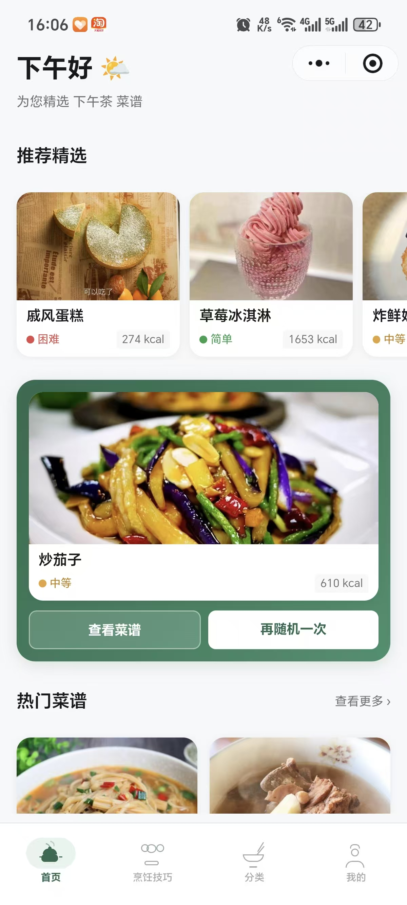
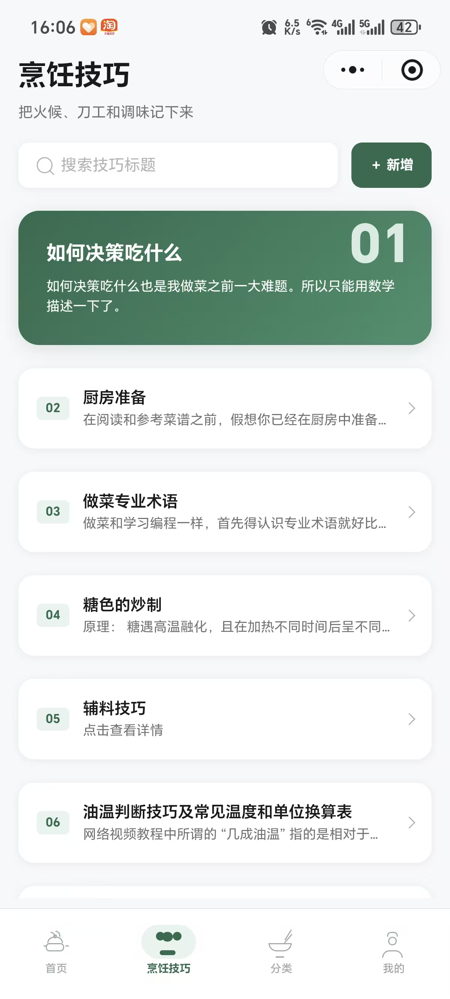
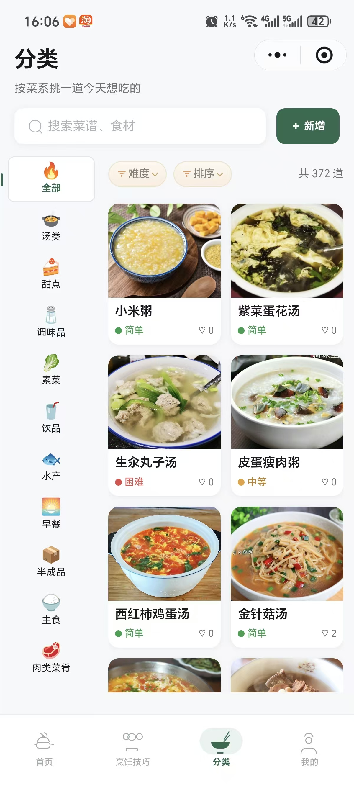
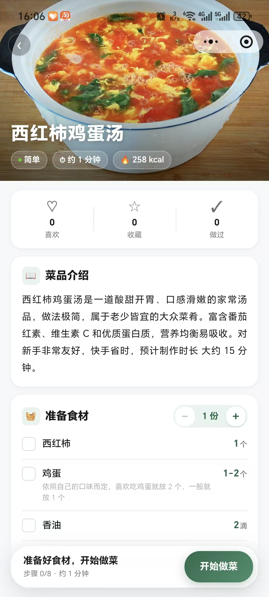

# 今天做什么菜（wx-food）

「今天做什么菜」是一款帮助用户发现菜谱、决定下一顿吃什么并跟着步骤下厨的微信小程序。项目包含 uni-app 小程序、微信云开发云函数与种子数据，也提供可选的公众号文章管理网页。

## 小程序体验

扫描下方二维码，打开「今天做什么菜」小程序。

  

## 功能介绍

- **随机选菜**：首页展示推荐菜谱，点击骰子随机挑选一道菜，减少饭点选择困难。
- **菜谱发现**：按菜系分类浏览，搜索菜名或食材，并按难度、热量等信息筛选和排序。
- **菜谱详情**：查看菜品介绍、食材、用量和制作步骤；烹饪时可以勾选食材、调整份量。
- **个人记录**：喜欢、收藏菜谱，标记做过的菜，并查看浏览记录。
- **烹饪技巧**：浏览和搜索烹饪技巧，查看详细内容。
- **内容管理**：管理员可管理菜谱、分类、技巧、用户与用户提交的内容。
- **公众号文章管理（可选）**：独立网页支持文章模板预览、草稿管理、发表记录和定时发表。它与小程序运行环境分开部署。

## 界面预览

<table>
  <tr>
    <td align="center"><strong>首页 · 随机选菜</strong> </td>
    <td align="center"><strong>烹饪技巧</strong> </td>
  </tr>
  <tr>
    <td align="center"><strong>分类与菜谱筛选</strong> </td>
    <td align="center"><strong>菜谱详情与下厨清单</strong> </td>
  </tr>
</table>

## 技术组成

| 模块 | 技术 |
| --- | --- |
| 微信小程序 | uni-app、Vue 3、Vite、Pinia |
| 数据与服务 | 微信云开发、云函数、云数据库、云存储 |
| 公众号文章管理网页（可选） | Node.js、Express、EJS、SQLite |

项目创建和部署步骤请见 [DEPLOYMENT.md](./DEPLOYMENT.md)。
